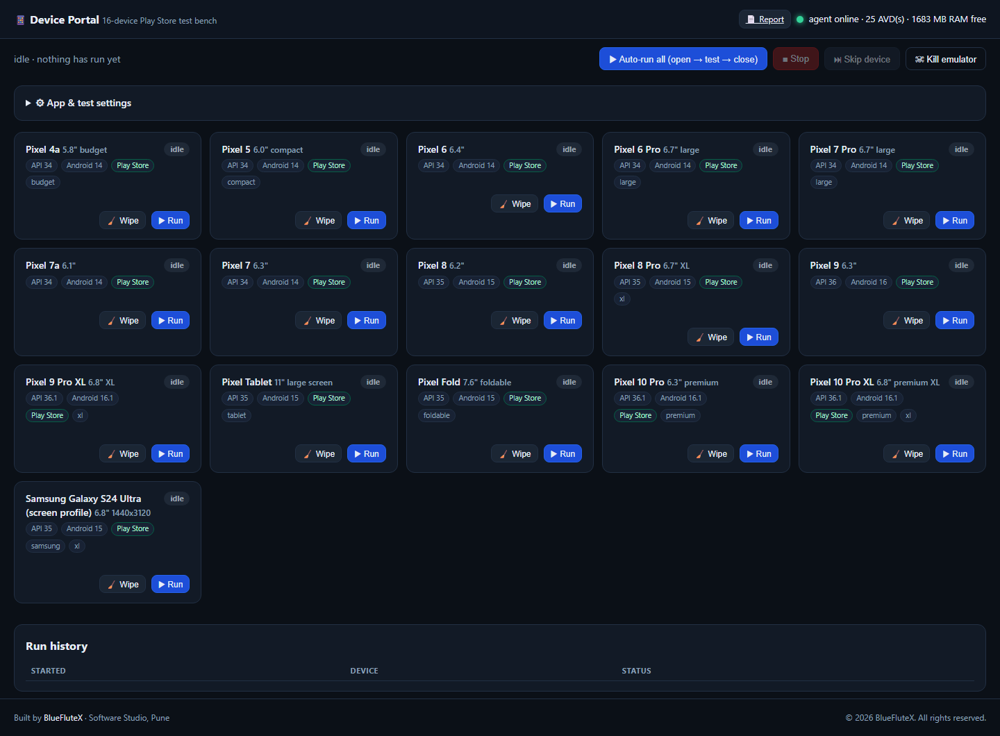
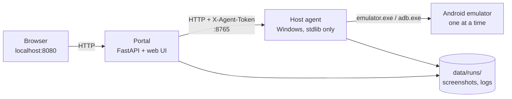

<div align="center">


# 📱 Android Device Portal

**Run your Android app through 16 device profiles — one emulator at a time, unattended.**

A self-hosted compatibility and smoke-test bench for Windows. Pick an APK, AAB,
or Play internal-testing link; the portal boots each emulator, installs and
launches the app, captures screenshots, scans for crashes/ANRs, writes a report,
and moves to the next device.

[](https://github.com/vikasdocker/android-device-portal/actions/workflows/ci.yml)
[](https://github.com/vikasdocker/android-device-portal/releases)
[](LICENSE)
[](https://www.python.org/)
[](#requirements)
[](#quick-start-docker)
[](https://blueflutex.gt.tc/)

[Features](#features) · [Architecture](#architecture) · [Quick start](#quick-start-docker) · [Device matrix](#the-16-device-matrix) · [Configuration](#configuration) · [Troubleshooting](#troubleshooting) · [Contributing](#contributing)

</div>

---



---

## Features

- **16-device matrix** — Pixel 4a through Pixel 10 Pro XL, Pixel Tablet, Pixel
  Fold, and a Galaxy S24 Ultra screen/density profile.
- **Sequential by design** — exactly one emulator runs at a time, sized for a
  16 GB laptop; no cloud account or device farm required.
- **Four install modes** — APK, AAB (`bundletool`), Play internal-testing link,
  or launch an app that is already installed.
- **Evidence per run** — screenshots, `logcat.txt`, `meminfo.txt`,
  `device.json`, and machine-readable `result.json`.
- **Crash and ANR detection** — scans the crash buffer and logcat, checks the
  process is still alive, and marks the run **pass / fail / error**.
- **Resilient booting** — RAM/disk preflight, stale-lock cleanup, snapshot
  validation, cold-boot retries, fallback GPU, and data wipe as a last resort.
- **Live web UI** — queue controls, per-device status, live screenshots, run
  history, and a printable HTML report.
- **Two deployment modes** — Docker Compose, or a no-Docker local virtualenv.
- **Token-protected agent** — the browser never sees the agent token.

> ⚠️ **What this is not:** emulators cannot act as Play Console testers. Google's
> closed-testing requirement for new personal accounts needs real testers with
> real Google accounts. This portal is for legitimate compatibility smoke
> testing, crash hunting, and generating Play Store screenshots. Emulators are
> stock Android and do not reproduce Samsung/Xiaomi skins; use a real device or
> a cloud device farm for that.

## Architecture



The Android emulator needs Windows Hypervisor Platform and the host GPU, so it
cannot run inside Docker on Windows. The portal therefore runs as a container
(or a local virtualenv) and a small Python agent on the host drives
`emulator.exe` and `adb.exe`. The agent has **zero pip dependencies**.

## Requirements

| Requirement | Details |
|-------------|---------|
| OS | Windows 10/11, 64-bit |
| CPU / RAM | 4 cores and 16 GB RAM recommended; the agent refuses a run when free RAM is too low |
| Disk | ~30 GB free: system images (~10 GB), JDK/tools, AVD data, screenshots |
| Virtualization | WHPX enabled in Windows Features; BIOS virtualization on |
| Python | 3.10+ on the host; the Docker image uses 3.12 |
| Android SDK | `emulator`, `platform-tools`, and a system image per profile |
| Java | JDK 17 for AAB mode; `scripts\setup_devices.ps1` installs one |
| Docker | Docker Desktop, only for the container mode |

## Quick start (Docker)

```powershell
# 1) Download system images and create all 16 AVDs (one time, ~10 GB)
scripts\setup_devices.ps1

# 2) Generate the agent token, firewall rule, and scheduled task
host-agent\install-agent.ps1

# 3) Verify SDK, acceleration, RAM, Docker, and agent
scripts\doctor.ps1

# 4) Start Docker Desktop, then:
docker compose up -d --build

# 5) Open the portal
Start-Process http://localhost:8080
```

Press **Auto-run all** to queue the full matrix. Each device is booted, tested,
closed, and shut down before the next one starts.

### No-Docker mode

Use this when Docker Desktop is unavailable or you want the portal directly on
the host:

```powershell
host-agent\run-agent.bat     # terminal 1 (or use the scheduled task)
scripts\run_host.ps1         # terminal 2 — creates portal\.venv on first run
```

Open <http://127.0.0.1:8080>.

> **Before a long run:** close Android Studio, Chrome, and other memory-heavy
> apps. The agent checks free RAM (guest RAM + headroom, minimum 3000 MB) before
> starting a device and waits briefly for a just-stopped emulator to release its
> memory.

## The 16-device matrix

Edit `config\devices.json` at any time; the portal reads it live. Every profile
uses an Android 14+ **Play Store** image (`google_apis_playstore`), so Play
internal-testing links and APK/AAB installs both work.

| # | Device | Screen | Android | API |
|---|--------|--------|---------|-----|
| 1 | Pixel 4a | 5.8" budget | 14 | 34 |
| 2 | Pixel 5 | 6.0" compact | 14 | 34 |
| 3 | Pixel 6 | 6.4" | 14 | 34 |
| 4 | Pixel 6 Pro | 6.7" large | 14 | 34 |
| 5 | Pixel 7 Pro | 6.7" large | 14 | 34 |
| 6 | Pixel 7a | 6.1" | 14 | 34 |
| 7 | Pixel 7 | 6.3" | 14 | 34 |
| 8 | Pixel 8 | 6.2" | 15 | 35 |
| 9 | Pixel 8 Pro | 6.7" XL | 15 | 35 |
| 10 | Pixel 9 | 6.3" | 16 | 36 |
| 11 | Pixel 9 Pro XL | 6.8" XL | 16.1 | 36.1 |
| 12 | Pixel Tablet | 11" large screen | 15 | 35 |
| 13 | Pixel Fold | 7.6" foldable | 15 | 35 |
| 14 | Pixel 10 Pro | 6.3" premium | 16.1 | 36.1 |
| 15 | Pixel 10 Pro XL | 6.8" premium XL | 16.1 | 36.1 |
| 16 | Samsung Galaxy S24 Ultra (screen profile) | 6.8" 1440×3120 | 15 | 35 |

Small phones get 2 GB, standard/premium phones 3 GB, and the three API 36.1
profiles get 4 GB (the emulator enforces that minimum). Allocations live in
`config\devices.json`.

> **Samsung caveat:** Google does not publish official Samsung/One UI emulator
> images. Profile 16 uses the Google Play Android 15 image with the Galaxy S24
> Ultra's **1440×3120 @ 505 dpi** geometry. It is useful for layout, density, and
> aspect-ratio testing — it is **not** a One UI firmware test.

## Install modes

| Mode | How it works | Needs |
|------|--------------|-------|
| **Already installed** | Launches the app already on the AVD; package name optional when exactly one third-party app is present | app installed once on each AVD |
| **Play link** | Opens the internal-testing URL in the emulator's Play Store; if the app is already installed, launches it directly | Play Store image + Google account signed in once per AVD + link |
| **APK** | `adb install -r -t -g <file>` | `.apk` path, or use **⬆ Upload APK** |
| **AAB** | `bundletool build-apks --device-id` + `install-apks` | `.aab` path + Java 17 |

The package name is optional wherever it can be inferred: after APK/AAB/Play
installs, and in already-installed mode when an AVD has exactly one third-party
app. Set it explicitly when an AVD has several apps.

## What happens in a run

1. **Preflight** — check free RAM/disk, clear stray emulators, start `adb`.
2. **Boot** — start the emulator with the profile's RAM/cores; wait for real
   `sys.boot_completed`; retry cold, fall back to software GPU, then wipe data.
3. **Install** — per the selected mode.
4. **Launch** — resolve the launcher activity and start it (`monkey` fallback).
5. **Observe** — wait, capture PNG screenshots at your offsets (default
   `2,8,20` s), read the crash buffer and logcat, check `pidof`, dump `meminfo`.
6. **Close** — `am force-stop` the app.
7. **Collect** — write `device.json`, `logcat.txt`, `meminfo.txt`, and
   `result.json` under `data\runs\<timestamp>_<device>\`.
8. **Shut down** — `adb emu kill`, with a force-kill fallback.
9. **Verdict** — **pass** (installed, launched, alive, no crash lines),
   **fail**, or **error**.

Artifacts are browsable from the portal (a card's **Details** or any run-history
row). **Report** renders a shareable HTML summary at `/api/report`.

## Portal controls

| Control | Action |
|---------|--------|
| ▶ Auto-run all | Queue every device in the matrix, strictly one at a time |
| ▶ Run (card) | Run just that device |
| ■ Stop | Stop the current run; when idle, cancel the queue |
| ⏭ Skip device | Abort the current device as "skipped" and continue |
| ☠ Kill emulator | Force-kill anything holding port 5554 |
| 🧹 Wipe (card) | Wipe that AVD's data on its next boot |
| 📄 Report | Printable HTML report with screenshots |

## Configuration

| File | Purpose |
|------|---------|
| `.env` | Agent URL, shared token, host data path; generated by `install-agent.ps1` |
| `config\devices.json` | Device matrix: AVD names, images, RAM, cores, tags |
| `host-agent\agent-config.json` | Generated agent settings: SDK path, Java, GPU, timeouts, limits |
| `portal\app\config.py` | Portal defaults and path resolution |
| `pyproject.toml` | Version, Python requirement, ruff and pytest configuration |

### Ports

| Port | Service | Exposure |
|------|---------|----------|
| `8080` | Portal UI/API | localhost, or Docker-published `8080` |
| `8765` | Host agent | localhost/LAN, token required |
| `5554` | Emulator console | used internally by the agent |

To change the portal port in no-Docker mode: `scripts\run_host.ps1 -Port 8090`.
For Docker, edit the `ports` mapping in `docker-compose.yml`.

## API

The portal exposes a small JSON API; the web UI uses the same endpoints.

| Method | Path | Purpose |
|--------|------|---------|
| `GET` | `/api/health` | Portal and agent health |
| `GET` | `/api/state` | Queue, devices, settings, agent status |
| `GET` / `POST` | `/api/settings` | Read or update test settings |
| `POST` | `/api/queue/start` | Start a queue (`device_ids` optional) |
| `POST` | `/api/queue/stop` | Stop the active run/queue |
| `POST` | `/api/queue/skip` | Skip the current device |
| `GET` | `/api/devices/{id}/live.png` | Live emulator frame |
| `POST` | `/api/devices/{id}/wipe` | Wipe an AVD on its next boot |
| `POST` | `/api/agent/kill-emulator` | Emergency emulator kill |
| `GET` | `/api/runs` | Run history (`?limit=50`) |
| `GET` | `/api/runs/{id}` | Run detail and artifact list |
| `GET` | `/api/runs/{id}/file?path=...` | Download an artifact |
| `POST` | `/api/upload` | Upload an APK/AAB |
| `GET` | `/api/report` | Printable HTML report |

Interactive OpenAPI docs are available at `/docs`.

## Project layout

```text
android-device-portal/
├─ docker-compose.yml          portal container
├─ config/
│  ├─ devices.json             the 16-device matrix (edit me)
│  └─ devices.full.json        full backup copy
├─ host-agent/                 Windows agent (stdlib only)
│  ├─ agent.py                 emulator/adb driver + HTTP API
│  ├─ agent-config.json        generated locally (git-ignored)
│  ├─ install-agent.ps1        token, firewall, scheduled task, start
│  └─ run-agent.bat            visible-console launcher
├─ portal/
│  ├─ app/                     FastAPI app, orchestrator, SQLite store
│  ├─ web/                     HTML/CSS/JS UI
│  ├─ requirements.txt
│  └─ Dockerfile
├─ scripts/
│  ├─ doctor.ps1               read-only environment check
│  ├─ setup_devices.ps1        tools + images + 16 AVDs
│  ├─ run_host.ps1             no-Docker launcher
│  └─ portal-service.ps1       scheduled-task wrapper
├─ tests/                      pytest suite for config and persistence
├─ data/                       runtime artifacts (git-ignored)
└─ tools/                      downloaded JDK / SDK tools (git-ignored)
```

## Time and resource expectations

- First setup downloads system images (~10 GB), JDK, cmdline-tools, and
  bundletool.
- Each device takes roughly **3–6 minutes** (cold boot 1–3 min + install,
  observe, shutdown).
- A full 16-device sweep takes **1.5–2 hours** unattended, using one 2–4 GB
  guest at a time.
- Quick boot cuts a warm rerun to well under a minute on some profiles, but the
  first boot of each image is still cold.

## Troubleshooting

| Symptom | Fix |
|---------|-----|
| `agent offline` in the UI | Start `host-agent\run-agent.bat` or re-run `install-agent.ps1` |
| `could not start: …` | Read the message — usually a missing APK path or an active queue |
| Emulator won't boot / dies instantly | The agent cleans stale locks and snapshots, retries cold, then wipes. Check `data\runs\<run>\emulator.log`; use ☠ Kill emulator, then retry |
| "only N MB RAM free" | Close Android Studio/Chrome. Standard profiles need guest RAM + 1024 MB; API 36.1 profiles need 4 GB guest RAM + 512 MB |
| Slow reruns | Enable **Quick boot** after one successful cold boot |
| Stale UI / boot loop | Enable **Wipe device data before each run** or use 🧹 Wipe |
| Stop button seems stuck | Stop kills the emulator process tree, including a hung `adb install` |
| Samsung One UI looks like stock Android | Expected — the S24 Ultra entry is a screen/density profile only |
| Firewall prompt / portal can't reach agent | Allow TCP 8765 (installer adds a rule when run as admin) |
| `docker compose up` fails | Start Docker Desktop; confirm `docker version` works |
| AAB install fails | Re-run `scripts\setup_devices.ps1` to fetch Java + bundletool |

## Security

- The agent requires `X-Agent-Token` on every request. The token is generated
  locally and stored in `.env` and `host-agent\agent-config.json`; both are
  git-ignored.
- The portal proxies screenshots, so the browser never receives the token.
- Run artifacts may contain sensitive app data. Treat `data/` as private and
  do not attach raw artifacts to public issues.
- Do not expose ports `8080` or `8765` directly to the internet. Use a VPN or an
  authenticated reverse proxy for remote access.

See [SECURITY.md](SECURITY.md) for the full policy and reporting process.

## Contributing

Contributions are welcome. Read [CONTRIBUTING.md](CONTRIBUTING.md) first, then:

```powershell
py -3 -m venv portal\.venv
.\portal\.venv\Scripts\python.exe -m pip install -r requirements-dev.txt
.\portal\.venv\Scripts\python.exe -m ruff check .
.\portal\.venv\Scripts\python.exe -m pytest
```

Please follow the [Code of Conduct](CODE_OF_CONDUCT.md). For security issues,
use the private reporting flow in [SECURITY.md](SECURITY.md), not a public issue.

## Built by BlueFluteX

Android Device Portal is designed and maintained by **BlueFluteX**, a software
studio in Pune, India. We build mobile, desktop, and AI systems that are
architected to be extended, not rewritten.

- **Website:** <https://blueflutex.gt.tc/>
- **Email:** <vikasshu7@gmail.com>
- **Studio:** Pune, Maharashtra, India
- **Tagline:** *Code with Harmony*

## License

Released under the [MIT License](LICENSE).

Copyright © 2026 **BlueFluteX**. All rights reserved.

---

<div align="center">
  <sub>Built with care by <a href="https://blueflutex.gt.tc/">BlueFluteX</a> · Pune, India</sub>
</div>
